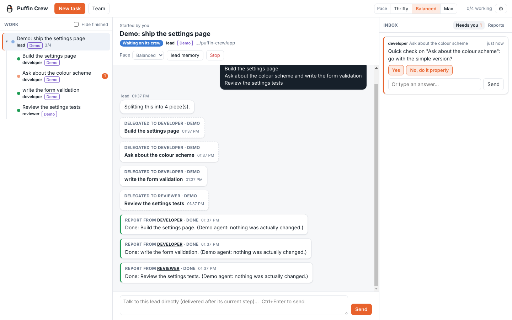

# Puffin Crew (desktop app)

A desktop app where Claude Code and Codex agents delegate work to each other and report back.
You follow the work as a tree and answer every agent's questions in one inbox.



## What it does

- **Agents delegate to each other.** Give a task to the `lead`. It hands pieces to other roles
  (`developer`, `reviewer`, `researcher`, or whatever team you set up). Each piece is a new agent:
  a real `claude` or `codex` process running underneath.
- **Reports travel up the tree, word for word.** A finished agent's report goes to whoever gave
  it the work, unchanged (the crew's deliver-first rule). An agent that ends without reporting has
  its last message passed up instead. Parents are woken when their agents report back.
- **One inbox for you.** Questions (`ask_human`) and permission prompts ("run `npm test`?") from
  every agent land in the inbox on the right. Answer with a click; "Always for this agent" stops
  repeat prompts for that tool.
- **Talk to any agent directly.** Click any node in the tree and message it. The app resumes that
  agent's own Claude or Codex session.
- **Pace.** Thrifty / Balanced / Max sets how many agents run at once and which model tier each
  uses (Claude: haiku / sonnet / opus by default; Codex: reasoning effort low / medium / high).
  Set it for the whole crew in the top bar, or per agent.
- **Hand to Codex / Hand to Claude.** Moves an agent's work to the other provider. The new
  session gets the original brief plus a record of what happened so far, so you don't re-explain.
- **Role memory.** Each role has one memory file that every agent with that role reads, in every
  project. Agents add to it with the `remember` tool; you can edit it from the role's Memory button.
- **Team from plain English.** In Team, describe how you want your agents to work ("a developer on
  Claude writes the code, Codex reviews every change, keep it cheap"). Claude Code designs the roles
  (or, without it, the app reads the description by keywords). You review and edit before saving.
- **Your puffins show up as roles.** Run from this repo and every `crew/<name>/persona.md` (Ledge
  today) appears as a role. Their memory stays read-only here, because the crew level-gates it.
- **Demo crew.** "Try the demo crew" runs pretend agents (no AI, no cost) through the same
  delegate / wait / ask / report tools, so you can see how it works before spending anything.

## Run it

Needs Node 18+ and at least one of [Claude Code](https://code.claude.com) (`claude`) or Codex
(`codex`) installed and signed in. Without either, only the demo crew works.

```bash
cd app
npm install
npm start
```

Settings (gear icon): permission mode, models per pace, how many agents run at once, default folder,
and the `claude` / `codex` commands if they aren't on your PATH (restart after changing those).
Crew data (agents, inbox, roles, memory) lives in the app's user-data folder, shown in Settings.
Set `CREW_DATA_DIR` to keep a separate crew, or `CREW_DIR` to load puffins from another `crew/` folder.

## How it works

```
 you ── inbox / tree / composer ──┐
                                  ▼
             Electron main: Orchestrator (src/orchestrator.js)
              ▲  loopback HTTP, per-agent token (src/bridge.js)
              │
   ┌──────────┴──────────────┐
   │ "crew" MCP server        │  src/mcp-shim.js, one per agent process
   │ delegate,                │
   │ wait_for_reports, report,│
   │ ask_human, remember,     │
   │ list_team, approve_tool  │
   └──────────┬──────────────┘
              │ stdio
   claude -p --output-format stream-json --mcp-config … --resume <session>
   codex exec --json -c mcp_servers.crew… [resume <thread>]
```

- One CLI process per turn. When a turn ends, the orchestrator decides what's next: done (it
  reported), waiting (its agents are still working), or a new turn (reports or your message arrived).
- Claude Code permission prompts go to the inbox through `--permission-prompt-tool mcp__crew__approve_tool`.
  Codex can't route prompts that way, so Codex agents run in its `workspace-write` sandbox without asking.
- Claude Code moves MCP calls that run past about two minutes into the background, so no crew tool
  blocks longer than 90 seconds. After that, your answer or the late reports arrive as a new message
  that resumes the agent's session.
- Agents can delegate at most 4 levels deep and 8 agents each (Settings file: `maxDepth`, `maxChildren`).

## Tests

```bash
npm test          # orchestrator, MCP shim over real stdio, event parsing, team design (no AI, no cost)
npm run e2e       # real Claude Code on Haiku: lead delegates, waits, asks you, reports (a few cents)
E2E_LATE=1 npm run e2e   # same, but the answer comes after the 90s cap, so it must resume the session
npm run shots     # drives the real window with the demo crew and saves screenshots (needs Playwright)
```

## Checked and not checked

Checked on Linux in this build: all of `npm test`; `npm run e2e` and `E2E_LATE=1 npm run e2e` against
Claude Code 2.1.316; a real Claude permission prompt answered from the inbox and the command running;
the MCP shim starting under the Electron binary; the full demo flow in the real window.

Not checked yet:
- **Codex.** Codex isn't installed where this was built. The Codex provider follows the documented
  `codex exec --json` events and `-c mcp_servers…` config, and its event parsing is unit-tested on sample
  events, but no real Codex run has gone through it. `codex exec … resume <id>` argument order is the
  most likely thing to need a fix.
- **macOS and Windows.** Built and run on Linux only. There are no packaged installers yet; run from source.
